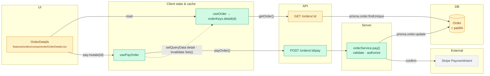
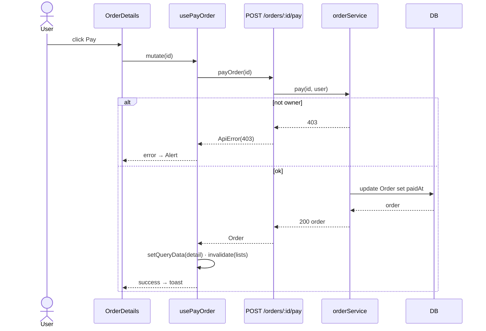
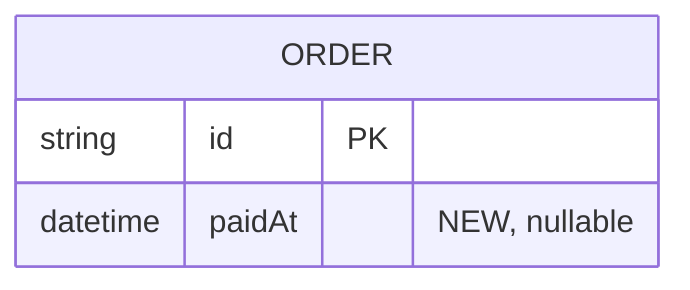

# Dataflow (as built): <Feature name>

- **Branch:** `feat/<slug>` @ `<sha>` · **Base:** `main`
- **Design:** [technical-design.md](./technical-design.md)
- Legend: 🟩 new · 🟨 changed · ⬜ read-only / affected (existing code that consumes changed data)

## 1. Overview

## 2. Write flows
### <Flow name>

## 3. Data model (added / changed only)

## 4. Data dictionary
| Model.field | Type | Null / default | Written by | Read by | PII |
|---|---|---|---|---|---|
| `Order.paidAt` | `DateTime` | nullable | `orderService.pay` | `GET /orders/:id`, `OrderDetails`, `reports/revenue.ts` ⬜ | no |

## 5. Cache map
| Query key | Filled by | Invalidated / updated by | staleTime |
|---|---|---|---|
| `orderKeys.detail(id)` | `GET /orders/:id` | `usePayOrder` (setQueryData) | 30s |
| `orderKeys.lists()` | `GET /orders` | `usePayOrder` (invalidate) | default |

## 6. Drift from design
| Design said | Built | Why |
|---|---|---|
| | | |

## 7. Not in the plan's impact map
-
