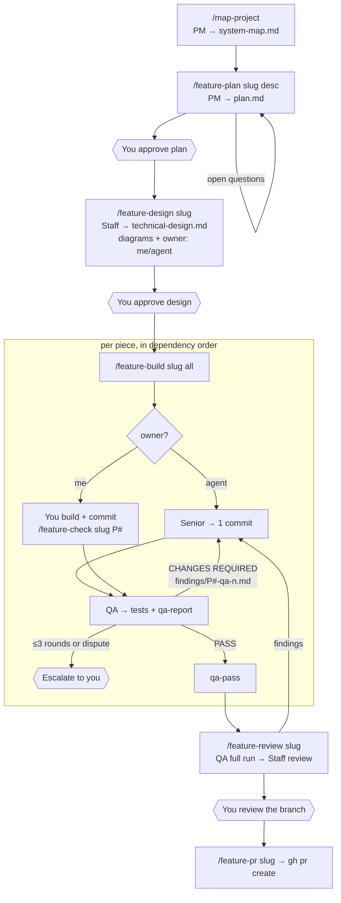

# Agent development workflow

Four Claude Code subagents plus slash commands that run them. You stay in control at every gate.



## Install

Copy into the root of each repo:

```
.claude/
  agents/      product-manager.md  staff-engineer.md  senior-engineer.md  qa-engineer.md
  commands/    map-project  feature-plan  feature-design  feature-build  feature-check  feature-review  feature-pr  feature-status
  hooks/       restrict-writes.mjs
  templates/   system-map.md  plan.md  technical-design.md  qa-report.md  status.md
  skills/      design-system  new-component  data-flow  forms  state-decision  figma-to-code  ui-verification  frontend-testing  guard-burndown
```

Then add the snippet from `CLAUDE.workflow-snippet.md` to the repo's `CLAUDE.md` and fill in the real commands. Every agent reads it to know how to typecheck, lint, test and run E2E. Commit `.claude/` so the team (and other machines) get the same setup.

Requires: Node (for the guard hook), `git`, `gh` (for the PR step).

## Roles

| Agent | Model | Writes | Never |
|---|---|---|---|
| `product-manager` | opus | `docs/**` | app code |
| `staff-engineer` | opus | `docs/**` (+ `owner` field in plan) | app code, fixes |
| `senior-engineer` | sonnet | app code, 1 commit per piece | tests for acceptance, `owner: me` pieces, pushes |
| `qa-engineer` | sonnet | tests, fixtures, mocks, `docs/features/**` | app code, weakening tests |

Change the `model:` lines to suit your budget. Opus for the two reasoning-heavy roles is the main thing worth keeping.

Write limits are **enforced** by a `PreToolUse` hook (`restrict-writes.mjs`), not just asked for in the prompt. If QA tries to edit `src/…`, the edit is blocked and QA is told to write a finding instead. The hook covers Edit/Write. QA and PM still have `Bash`, which they need to run tests and git, so the prompt also forbids shell-based edits. Tighten the regexes in the hook's `PROFILES` to match your repo layout.

## Per-feature files (the handoff contract)

```
docs/
  architecture/system-map.md          # long-lived project understanding
  features/<slug>/
    plan.md               # PM: objective, impact, R-ids, T-ids, P-ids
    technical-design.md   # Staff: contracts, diagrams, per-piece scope, owner
    status.md             # orchestrator: piece states + gates
    qa-report.md          # QA: R → tests → PASS/FAIL with evidence
    findings/P2-qa-1.md   # QA → Senior requested changes
    findings/P2-staff-1.md
    staff-review.md       # Staff: final verdict
```

Agents pass **file paths**, not chat summaries, so every decision can be traced and the work survives `/clear` or a new session. Pick up anywhere with `/feature-status <slug>`.

IDs tie it together: `R#` requirement → `T#` acceptance test → `P#` piece → commit `[slug P#]` → test name `[T#][R#]`.

## Typical run

```
/map-project                                   # once per repo, refresh occasionally
/feature-plan coupon-codes "Users can apply a coupon at checkout… (ticket link)"
  → answer open questions → review plan.md → "approved"
/feature-design coupon-codes
  → read diagrams, note your core pieces → "approved"
/feature-build coupon-codes all
  → it stops at your piece (e.g. P2 discount calculation)
  → you build + commit:  feat(checkout): discount engine [coupon-codes P2]
/feature-check coupon-codes P2
/feature-build coupon-codes all                # continues after P2
/feature-review coupon-codes
  → read the lead review brief, review the diff yourself
/feature-pr coupon-codes
```

## Skills

`.claude/skills/` holds project skills. Agents load them on demand, and the agent files list which skills each role gets. Skills with a `scripts/` folder push the mechanical part into a tested script, so the agent spends tokens on judgement, not boilerplate.

| Skill | Used by | What it gives the agent | Script |
|---|---|---|---|
| `design-system` | PM, Staff, Senior | catalog of primitives (props, variants), token rules, what to do about gaps | `build-catalog.mjs`: generates `catalog.md` from `src/components/ui` (React + Vue), `--check` for CI |
| `new-component` | Senior | where a component lives, then scaffolding that already passes the guards | `scaffold-component.mjs`: component + test + story + public-API export |
| `data-flow` | Staff, Senior | Prisma → API → client fn → query hook → UI states; key factories, invalidation | references for TanStack Query (React) and Vue Query/Nuxt |
| `forms` | Senior | zod schema first, field primitives, server-error mapping, a11y | references for react-hook-form and vee-validate |
| `state-decision` | Staff, Senior | decision tree: server cache / URL / form / derived / local / context / store | n/a |
| `figma-to-code` | Staff | design → primitives/tokens mapping table, gap handling, visual check | `nearest-token.mjs`: raw value → closest token (OKLab colors, CSS vars, Tailwind v4 `@theme`, JSON tokens) |
| `ui-verification` | Senior, QA | real-browser check before "done" | `verify-ui.mjs`: screenshots per breakpoint, overflow, console/runtime errors, failed requests, a11y (axe if installed), focus order |
| `frontend-testing` | QA | test level choice, Testing Library + MSW + factories, Playwright, `[T#][R#]` naming, anti-patterns | references for React, Vue, E2E |
| `guard-burndown` | Senior / you | pays down `.react-guards-baseline.json` in small, behaviour-safe slices | `baseline-report.mjs`: summary, `--next` slice, `--slice` file lists |

Add `.ui-verify/` to `.gitignore`. The skills assume the guard scripts and the conventions in `CLAUDE.md`. Adjust paths (`src/components/ui`, `src/api`, `@/`) in each SKILL.md if a project differs.

## Guard scripts

`scripts/react/` has deterministic checks that agents run instead of spending tokens on rule-following reviews. See [scripts/react/README.md](scripts/react/README.md).

| Script | Catches |
|---|---|
| `check-primitives.mjs` | raw HTML tags (`<input>`, `<button>`…) that should be design-system primitives |
| `check-design-tokens.mjs` | hardcoded colors, px/rem values, Tailwind arbitrary values |
| `check-naming.mjs` | file/folder/component/hook naming, one component per file |
| `check-component-size.mjs` | god components: length, state, effects, props, JSX depth |
| `check-data-fetching.mjs` | fetch/axios outside the API layer, fetching in `useEffect` |
| `check-all.mjs` | all of the above in one pass, the one to use in hooks and CI |

All share one config (`react-guards.config.json`), support `--changed`, `--hook` and a baseline for existing codebases.

`configs/eslint/` has an ESLint flat-config template for **import rules**: UI libraries only inside the primitives folder, layer boundaries, and features only importable through their public API. See [configs/eslint/README.md](configs/eslint/README.md).

## Tuning tips

- **Piece size**: if the senior agent's commits get large, tighten "~300 lines" in the PM prompt. Small pieces make QA rounds much cheaper.
- **Parallelism**: pieces with no dependency between them can be built in parallel using worktrees (`isolation: worktree`). Start serial, and add this once the flow feels reliable.
- **Your core pieces**: if Staff marks too much or too little as `owner: me`, edit the examples list in `staff-engineer.md` with your own rules (e.g. "anything touching Prisma migrations is always me").
- **Escalation limits**: 3 QA rounds per piece and 2 staff rounds are set in the commands. A piece that loops usually means the design was wrong, not the code.
